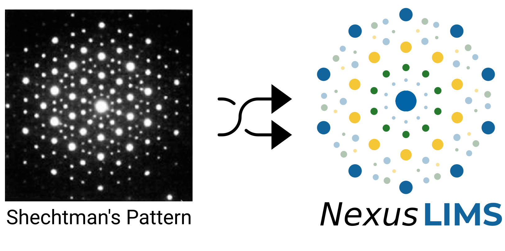

# Welcome to NexusLIMS!

The project serves as the development and documentation space for the back-end
of the Nexus Microscopy Facility Laboratory Information Management System
(NexusLIMS), co-developed by the NIST Office of Data and Informatics (ODI) and
Euclid Techlabs, LLC.

## Important note before getting started

As part of the process of open-sourcing this code, a number of private internal
references to NIST infrastructure have been removed in the [first
NexusLIMS release](https://github.com/usnistgov/NexusLIMS) (Released on
02/02/2021 with commit **a8e051a**).

Since then, NexusLIMS has been collaboratively worked on by the team at
[Euclid Techlabs, LLC](https://www.euclidtechlabs.com) with a shared goal of
making and releasing an facility-independent, platform-independent version of
NexusLIMS. Our goal is to allow non-NIST users to readily deply NexusLIMS in
a relatively straightforward way, such as using `pip install`.

The work is supported by an [SBIR](https://science.osti.gov/sbir/About)
award from the U.S. Department of Energy (DoE) under contract number
**DE-SC0021512**.

## How to get started?

We have created a _Getting Started_ section in the [documentation](https://euclidtechlabs.github.io/nexuslims). Users can follow the steps
described there to deploy the NexusLIMS package and start using it.

## Where to get help?

Most typical users will have little reason to interact directly with the
NexusLIMS back-end code contained in this repository, since it should operate
completely automatically and builds experimental records if the user follows
the instructions included in the documentation above.

However, we have also included a _Developer documentation_ section in the
documentation, if one chooses to customize the code for the unique network
and server infrastructure at the user's facility.

Furthermore, users are encouraged to contact the Euclid Techlabs
[developers](AUTHORS.rst) for more questions about NexusLIMS.

## About the NexusLIMS logo

The logo for the NexusLIMS project is inspired by the Nobel Prize
[winning](https://www.nobelprize.org/prizes/chemistry/2011/shechtman/facts/)
work of
[Dan Shechtman](https://www.nist.gov/content/nist-and-nobel/nobel-moment-dan-shechtman)
during his time at NIST in the 1980s. Using transmission electron
diffraction, Shechtman measured an unusual diffraction pattern that
ultimately overturned a fundamental paradigm of crystallography. He had
discovered a new class of crystals known as
[quasicrystals](https://en.wikipedia.org/wiki/Quasicrystal), which
have a regular structure and diffract, but are not periodic.

The NIST developers chose to use Shechtman’s
[first published](https://journals.aps.org/prl/pdf/10.1103/PhysRevLett.53.1951)
diffraction pattern of a quasicrystal as inspiration for the NexusLIMS
logo due to its significance in the electron microscopy and
crystallography communities, together with its storied NIST heritage:

## About the developers

The author information for the NexusLIMS project can be found in
[AUTHORS.rst](AUTHORS.rst).
